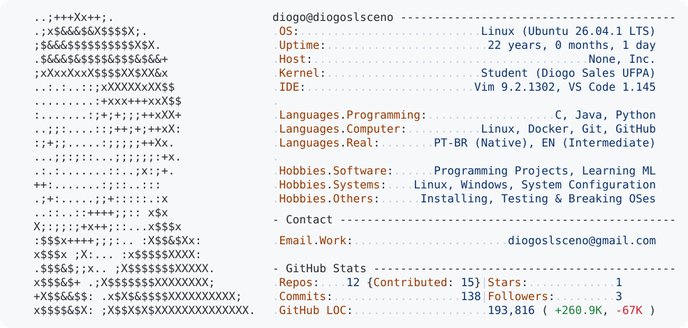

<a href="https://github.com/diogoslsceno/diogoslsceno">
  <picture>
    <source
      media="(prefers-color-scheme: dark)"
      srcset="https://raw.githubusercontent.com/diogoslsceno/diogoslsceno/main/dark_mode.svg"
    >
    <source
      media="(prefers-color-scheme: light)"
      srcset="https://raw.githubusercontent.com/diogoslsceno/diogoslsceno/main/light_mode.svg"
    >
    
  </picture>
</a>

<picture>
  <source
    media="(prefers-color-scheme: dark)"
    srcset="https://raw.githubusercontent.com/diogoslsceno/diogoslsceno/output/pacman-contribution-graph-dark.svg"
  >
  <source
    media="(prefers-color-scheme: light)"
    srcset="https://raw.githubusercontent.com/diogoslsceno/diogoslsceno/output/pacman-contribution-graph.svg"
  >
  
</picture>
